# DayFlow

  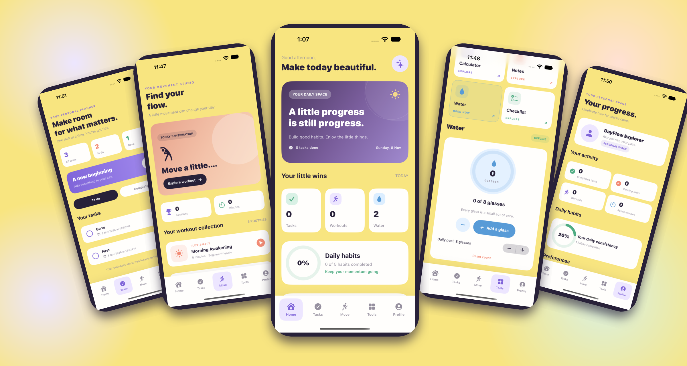

DayFlow is a SwiftUI iOS app for daily habits, tasks, movement, and small everyday tools — in one calm, colorful space.

The home screen greets you, tracks little wins, and keeps water, workouts, and habits in view. Tasks support local reminders. Move has short beginner-friendly routines. Tools include a calculator, notes, water tracking, and a daily checklist. Everything is stored on-device.

## Features

- **Home** — greeting, daily progress, habits, and a snapshot of tasks, workouts, and water
- **Tasks** — add reminders with date, time, and local notifications
- **Move** — short flexibility and movement routines with a simple timer
- **Tools** — calculator, notes, water glasses, and a daily ritual checklist
- **Profile** — activity totals, habit consistency, and preferences

Built with SwiftUI. Data stays on the device via `UserDefaults`; reminders use local notifications.

## Screenshots

  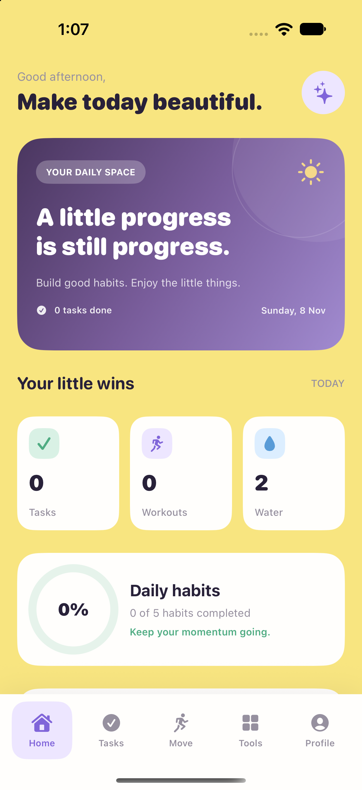
  &nbsp;
  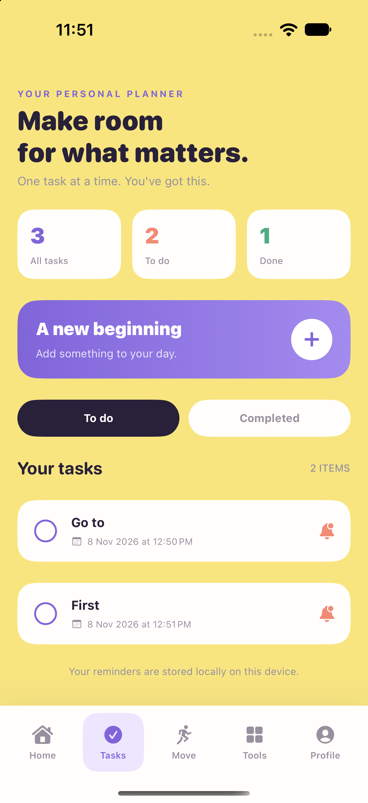
  &nbsp;
  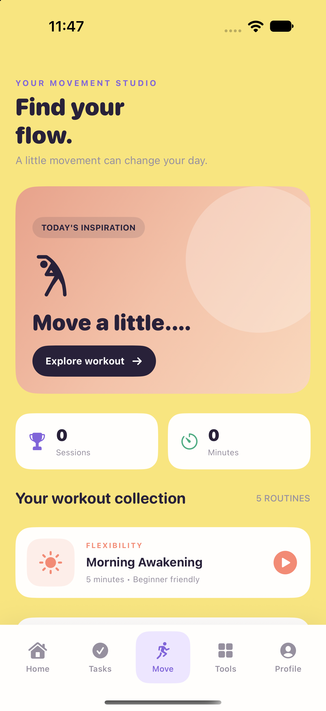

  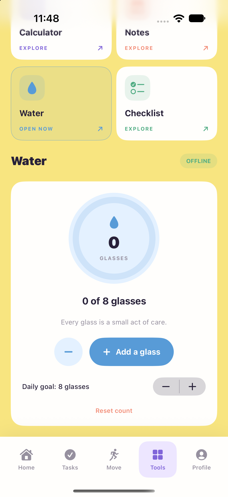
  &nbsp;
  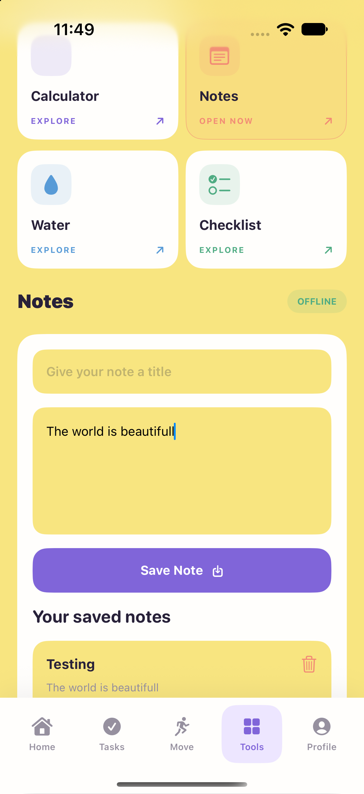
  &nbsp;
  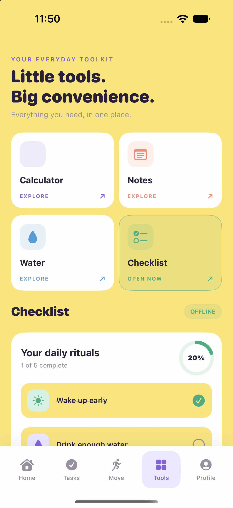

  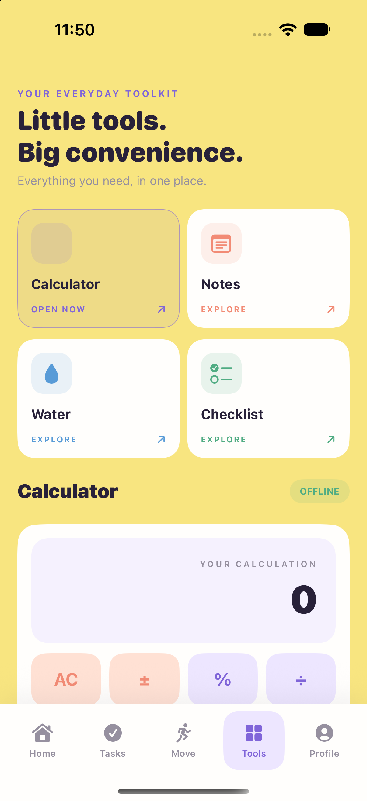
  &nbsp;
  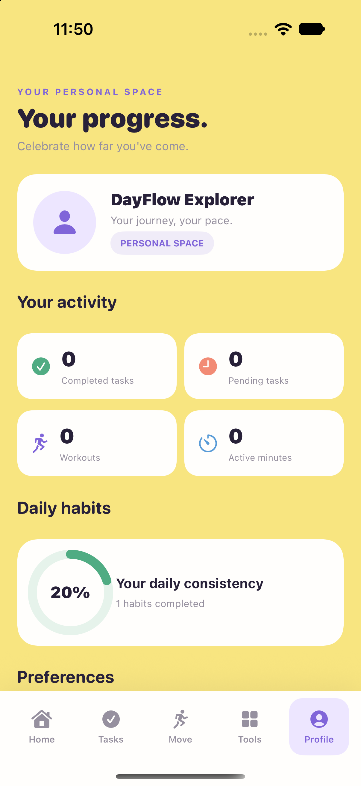
  &nbsp;
  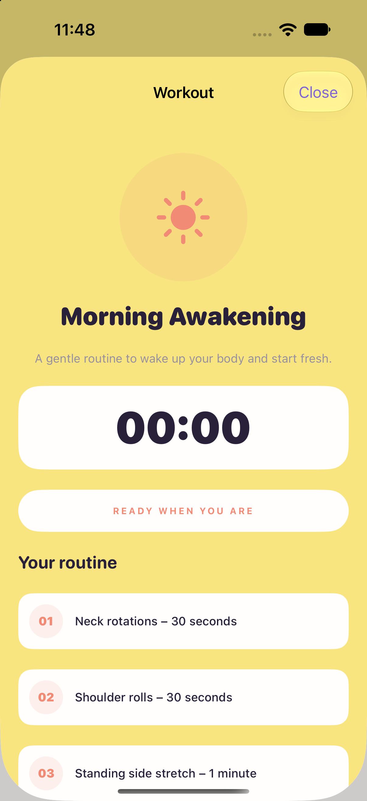

  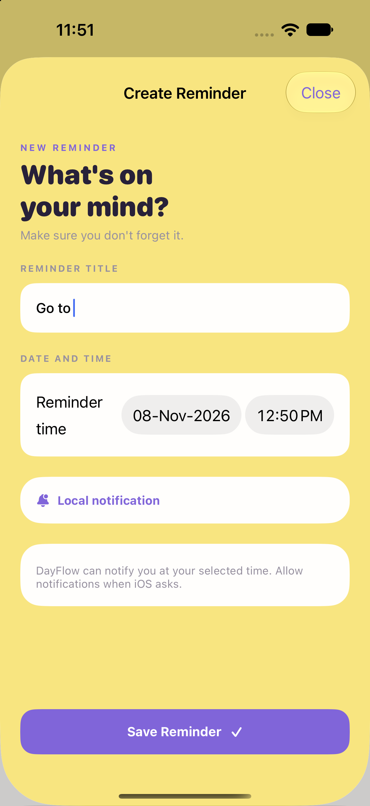

## Requirements

- Xcode 16+
- iOS 17+

Open `DayFlow.xcodeproj` and run the **DayFlow** scheme on a simulator or device.
